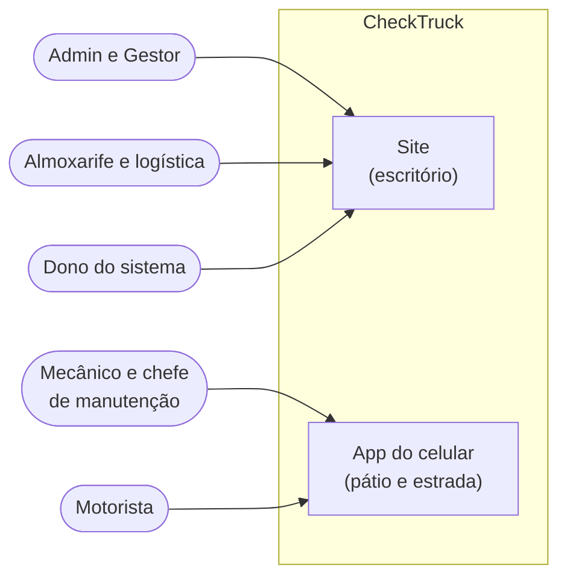
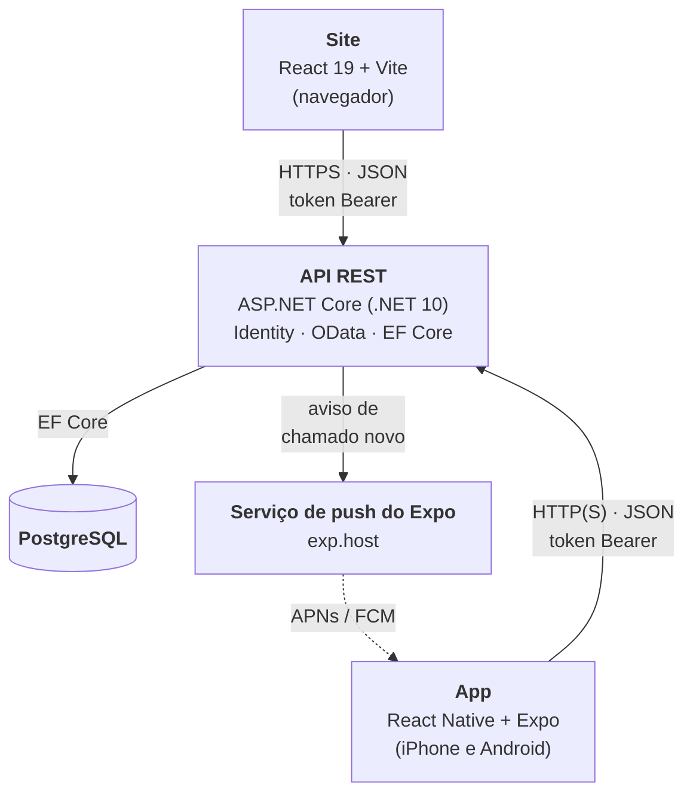
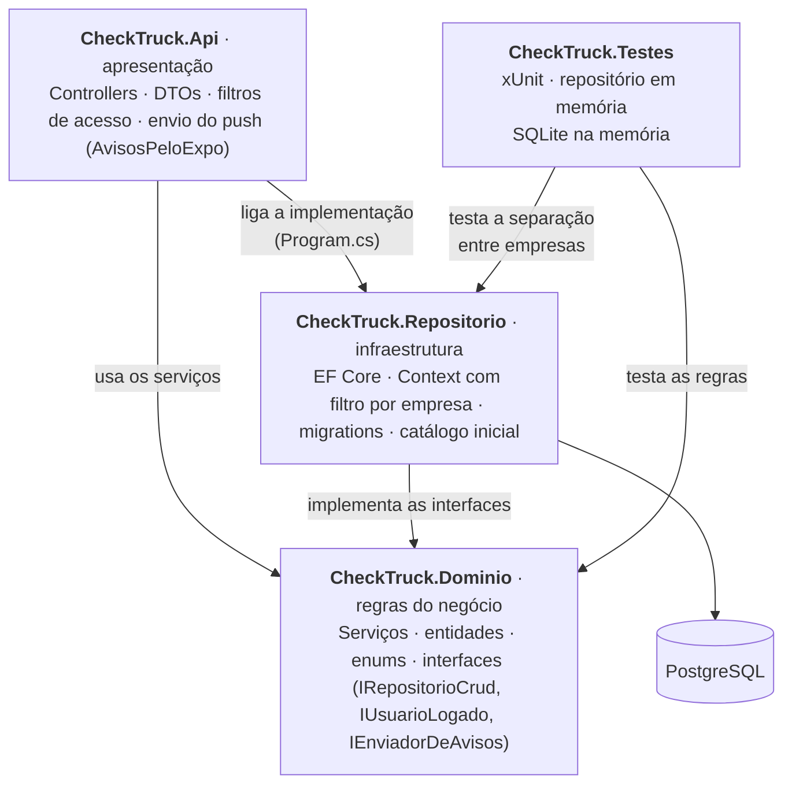
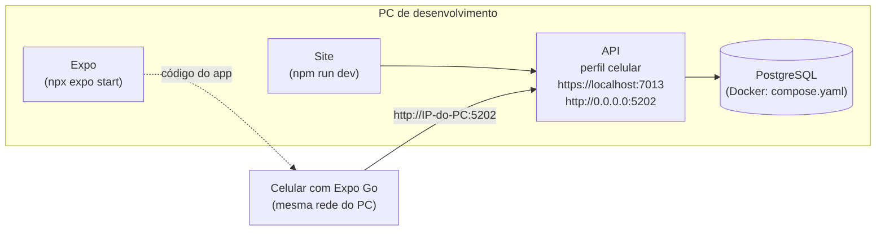

# Arquitetura

O CheckTruck controla a manutenção preventiva de caminhões: diz o que está perto de vencer (por km e por prazo),
guarda o histórico de ordens de serviço (OS) de cada caminhão e recebe os chamados dos motoristas. É um **SaaS
multiempresa (B2B)**: o dono do sistema cadastra cada empresa cliente com o login do Admin dela, o Admin cadastra a
equipe, e cada empresa só vê os próprios dados.

## Visão geral (contexto)

Quem usa o sistema e por onde.

O site é para quem está no computador (cadastros, acessos, dashboard, lançamento de OS). O app é para quem está
no pátio e na estrada: ver a situação dos caminhões, atualizar o km, abrir e atender chamados e receber avisos.
Qualquer um pode usar os dois; o diagrama mostra o uso principal de cada perfil.

## Containers

As partes que rodam separadas e como conversam.

- **Site e app são o mesmo sistema:** usam a mesma API, o mesmo banco e o mesmo login. O que muda num aparece no
  outro ao recarregar a tela.
- **Toda regra fica na API.** Site e app só mostram e validam antes de enviar (para avisar mais rápido); a API
  valida de novo e calcula tudo (próxima troca, status, alertas).
- **Push:** a API manda o aviso de chamado novo para o serviço do Expo, que entrega no celular (Apple ou Google).
  Os avisos de troca não passam pelo servidor: o próprio celular agenda.

## Camadas do backend

| Projeto | Responsabilidade | Depende de |
|---------|------------------|------------|
| `CheckTruck.Api` | Recebe os pedidos HTTP, confere o login e as permissões, converte DTO ↔ entidade e devolve os erros num formato só (ProblemDetails, com a mensagem em `detail`). Também manda o push pelo Expo. | Repositorio (e, por ele, Dominio) |
| `CheckTruck.Dominio` | Entidades, enums e **todas as regras**: cálculo da próxima troca e do status, ordem dos intervalos, km que só sobe, chamados, acessos. Não conhece banco nem HTTP: fala com eles por interfaces. | — |
| `CheckTruck.Repositorio` | Entity Framework Core com PostgreSQL: contexto, configuração das tabelas, migrations, catálogo inicial e o filtro por empresa. | Dominio |
| `CheckTruck.Testes` | 129 testes automáticos (xUnit): as regras do Dominio, com um repositório em memória no lugar do banco, e a separação entre empresas, com o `Context` de verdade num SQLite na memória. | Dominio e Repositorio |

O Dominio fica no centro e não depende de ninguém: as interfaces (`IRepositorioCrud`, `IUsuarioLogado`,
`IEnviadorDeAvisos`) são dele, e a Api e o Repositorio as implementam (inversão de dependência). Por isso as
regras podem ser testadas sem banco, trocando o repositório por um em memória.

### Caminho de um pedido

1. O filtro de acesso lê o token, carrega quem está logado (com a empresa) e barra quem não está logado, está
   inativo ou é de uma empresa desativada (401) e quem não tem a permissão da rota (403).
2. O ASP.NET valida o DTO (campos obrigatórios, tamanhos) e devolve 400 se faltar algo.
3. O controller chama o serviço do Dominio, que aplica as regras e junta as mensagens de erro em português.
4. O repositório grava pelo EF Core; o `Context` põe a empresa de quem está logado em todo registro e filtra todas
   as consultas por ela.
5. O controller devolve o DTO (ou o erro como ProblemDetails).

## Organização do site e do app

| | Site (`Checktruck.Web`) | App (`CheckTruck.Mobile`) |
|---|---|---|
| Telas | `src/pages` (uma por item do menu) e `src/paginas.jsx` (rota, menu e permissão de cada tela) | `src/app` (cada arquivo é uma rota do Expo Router; janelas que sobem como modal) |
| Peças | `src/components` (layout, janelas, formulários) | `src/componentes` e `src/telas` (tela inicial de cada perfil) |
| Falar com a API | `src/services` (axios, um serviço por recurso; renova o login) | `src/servicos` (fetch, um arquivo por recurso; sessão com renovação) |
| Nomes e formatos | `src/data` | `src/dados` (iguais aos do site) |

Os dois mostram só o que as permissões de quem entrou liberam, mas quem decide de verdade é a API.

## Decisões de arquitetura

| Decisão | Por quê |
|---------|---------|
| **Camadas (Api → Dominio ← Repositorio)** | Regras num lugar só, testáveis sem banco; trocar o banco ou a forma de entrega (site, app) não mexe nelas. |
| **Cálculo da situação no servidor** (`ServicoSituacaoVeiculo`) | Site, app e dashboard mostram exatamente o mesmo status; a regra de alerta existe uma vez só. |
| **Multiempresa por coluna `EmpresaId` + filtro global do EF Core** | Um banco para todos os clientes (barato para um SaaS pequeno). A empresa nunca vem do front: o `Context` grava a de quem está logado e filtra toda consulta, e todo UPDATE/DELETE leva a empresa no WHERE. |
| **Empresas cadastradas pelo dono do sistema** (sem criar conta) | O CheckTruck é B2B: quem libera o uso é o dono do sistema, e cada empresa cuida dos próprios acessos. Desativar a empresa, em vez de excluir, guarda os dados e corta o login de todos de uma vez. |
| **Catálogo do sistema + da empresa** | O dono do sistema mantém fabricantes, modelos, gerações e intervalos de fábrica para todos; cada empresa acrescenta o que falta, e só ela vê. |
| **Cargo + permissões por pessoa** (em vez de 3 perfis fixos) | Cada empresa tem cargos diferentes; o Admin ou Gestor libera uma permissão por vez. As permissões ficam num número só no banco (cada uma é um bit). |
| **ASP.NET Identity com token Bearer** | Login pronto e seguro (senha com hash, bloqueio após tentativas erradas). O token vale 1 hora e o site e o app renovam sozinhos com a chave de renovação (14 dias); trocar senha ou e-mail, ou desativar o acesso ou a empresa, encerra a renovação. |
| **OData nas listas** | Filtro, ordenação e paginação (`$filter`, `$orderby`, `$top` até 100, `$skip`, `$count`) sem escrever uma rota para cada caso. |
| **Push pelo Expo** | Um envio só para iPhone e Android, sem guardar chave da Apple ou do Google na API. Se o aviso falhar, o chamado continua aberto. |
| **Avisos de troca no próprio celular** | Funcionam sem servidor e sem internet na hora do aviso; o app refaz a agenda toda vez que abre. |
| **Expo (React Native) para o app** | Um código só para iPhone e Android, em TypeScript, como o documento do TCC prevê. |

## Segurança

- Senhas com hash do ASP.NET Identity; 5 tentativas erradas bloqueiam o login por alguns minutos.
- Toda rota, menos login e renovação, exige o token. Acesso inativo ou de empresa desativada recebe 401 mesmo com
  token válido.
- Não existe criar conta: só o dono do sistema cadastra empresas, e só o Admin ou o Gestor cadastra acessos.
- Permissões conferidas na API por filtros (`ExigePermissao`, `SomenteGestao`, `SomenteDonoDoSistema`); o site e o
  app só escondem o que a pessoa não pode usar.
- Dados separados por empresa no `Context` (filtro global), e não por cada tela.
- No celular, os tokens ficam no cofre do aparelho (Keychain no iPhone, Keystore no Android).
- HTTPS obrigatório fora de desenvolvimento. Em desenvolvimento, o app fala por HTTP na rede local (perfil
  `celular`), porque o certificado de desenvolvimento só vale no PC.

## Como roda hoje

Ainda não há servidor na nuvem: a API, o banco e o site rodam no PC, e o celular precisa estar na mesma rede.
Os passos estão no [README](../README.md#como-rodar).

## Qualidade

- **Testes automáticos:** 129 casos (xUnit) cobrindo intervalos padrão, regras de alerta, situação do caminhão,
  OS, motorista, veículo, aviso de chamado no celular, empresas, CPF, CNPJ, placa e a cor de cada conta.
- **Separação entre empresas testada no banco:** com o `Context` de verdade (SQLite na memória), duas empresas e
  o catálogo do sistema, os testes provam que uma empresa não vê, não altera e não exclui o que é da outra (nem
  mandando o id), que o registro novo fica sempre com a empresa de quem está logado, que o item do sistema só o
  dono do sistema muda e que os acessos também ficam separados (`SeparacaoEntreEmpresasTests`).
- **CI (GitHub Actions):** a cada push na `main` e em todo pull request, compila a API e roda os testes, confere e
  compila o site e confere os tipos do app (`.github/workflows/ci.yml`).
- **Documentação da API:** Scalar em `/docs` (com a API rodando em desenvolvimento).
