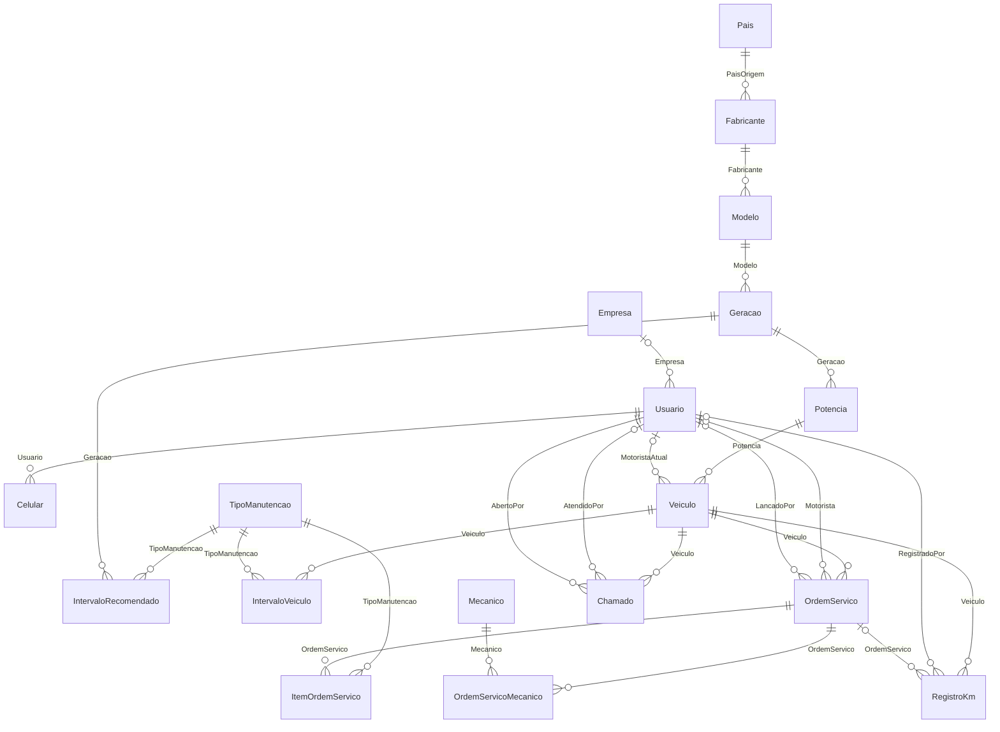
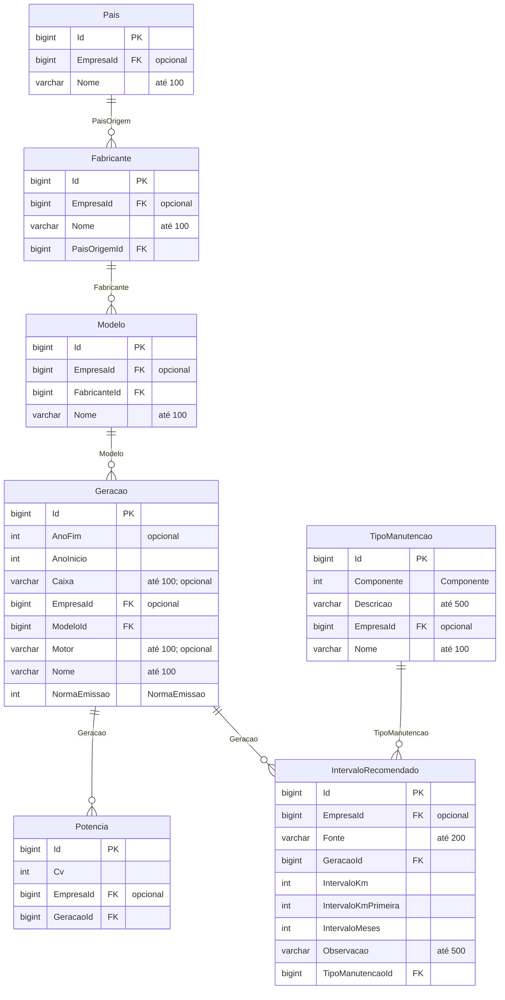
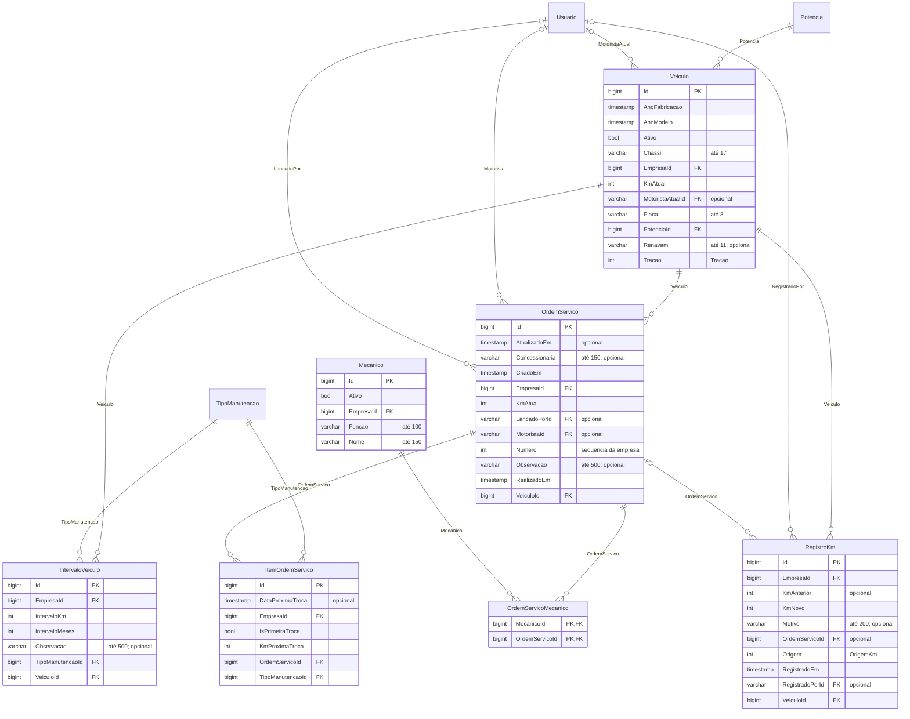
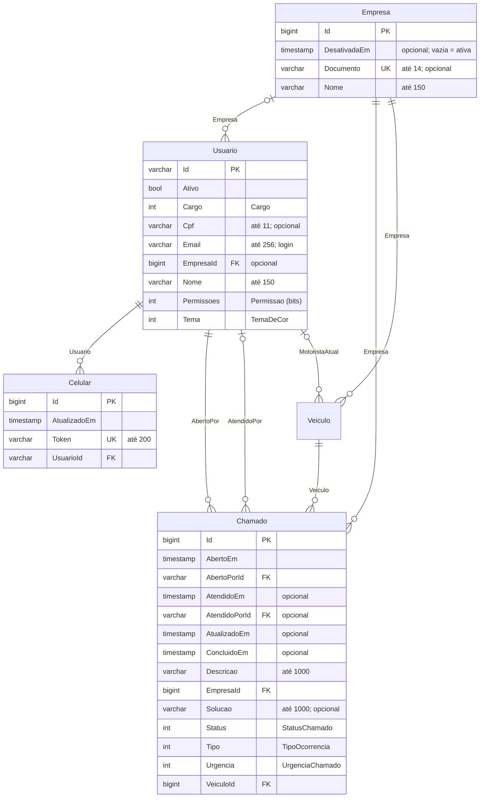

# Banco de dados

PostgreSQL, acessado pela API com o Entity Framework Core. As tabelas nascem das **migrations**
(`CheckTruck.Repositorio/Migrations`), e os diagramas abaixo foram gerados a partir do modelo do EF
(`ContextModelSnapshot.cs`), então mostram o banco como ele é.

São 17 tabelas do sistema, mais a tabela de ligação `OrdemServicoMecanico` e três tabelas auxiliares do
ASP.NET Identity (`AspNetUserClaims`, `AspNetUserLogins` e `AspNetUserTokens`, que o sistema não usa
diretamente).

## Visão geral



`||--o{` = um para muitos, obrigatório do lado "um" · `|o--o{` = um para muitos, opcional (a coluna pode ficar vazia).

## Separação por empresa (multiempresa)

Todos os clientes ficam no mesmo banco, e a coluna `EmpresaId` diz de quem é cada registro:

| Tipo de tabela | Tabelas | `EmpresaId` |
|---|---|---|
| **Dados da empresa** | Veiculos, OrdensServico, ItensOrdemServico, RegistrosKm, IntervalosVeiculo, Mecanicos, Chamados | Obrigatória |
| **Catálogo** | Paises, Fabricantes, Modelos, Geracoes, Potencias, TiposManutencao, IntervalosRecomendados | Vazia = do sistema (todos veem, só o dono do sistema muda); preenchida = da empresa (só ela vê) |
| **Acessos** | AspNetUsers (Usuario) | A empresa da pessoa; vazia só no dono do sistema |
| **Empresas** | Empresas | É a própria empresa |
| **Celulares** | Celulares | Não tem: a empresa é a da pessoa dona do celular |

A empresa **nunca vem do site ou do app**. O `Context` do EF grava a empresa de quem está logado em todo
registro novo, filtra toda consulta por ela (filtro global) e põe a empresa no WHERE de todo UPDATE e DELETE.
Assim, um cliente não vê nem altera os dados de outro, mesmo que mande o id de um registro alheio. Os testes
`SeparacaoEntreEmpresasTests` provam isso no banco (SQLite na memória, com o mesmo `Context`): consulta, busca pelo
id, UPDATE e DELETE com o id de outra empresa, registro novo, catálogo e acessos.

## Catálogo e intervalos



O caminhão aponta para uma **potência**, e por ela chega à geração, ao modelo e ao fabricante. Os intervalos de
troca ficam na **geração**: um de fábrica (sem empresa) e, se a empresa quiser, um dela, para cada tipo de
manutenção.

## Frota: caminhões, OS e km



- Uma **OS** tem um ou mais **itens** (um por tipo de manutenção) e um ou mais **mecânicos** (tabela de ligação).
  Cada item guarda a próxima troca (km e data).
- Toda mudança de km fica em **RegistrosKm**: de quanto para quanto, de onde veio (cadastro, Atualizar km, OS,
  edição ou correção), o motivo da correção, quem e quando.
- **IntervalosVeiculo** são os intervalos próprios de um caminhão (ex.: plano da concessionária), que valem antes
  de todos os outros.

## Contas, acessos e chamados



O `Usuario` é a tabela `AspNetUsers` do ASP.NET Identity. O diagrama mostra só as colunas do CheckTruck; as
outras são do Identity (hash da senha, carimbo de segurança, bloqueio por tentativas erradas, etc.).

## Restrições

**Valores que não repetem** (índices únicos no banco):

| Tabela | Não repete |
|---|---|
| Empresas | Documento (CNPJ; nas contas antigas de uma pessoa só, o CPF) |
| AspNetUsers | E-mail (login), em todo o sistema; CPF, dentro da empresa |
| Veiculos | Placa e chassi, dentro da empresa |
| OrdensServico | Número da OS, dentro da empresa |
| Potencias | Potência (cv) dentro da geração |
| IntervalosRecomendados | Um de fábrica por geração e tipo; um por empresa, geração e tipo |
| IntervalosVeiculo | Um por caminhão e tipo |
| ItensOrdemServico | Cada tipo uma vez por OS |
| Celulares | Token do celular |

Nomes de país, fabricante e tipo de manutenção também não repetem (e o de modelo, dentro do fabricante), mas
isso é conferido na API, para dar uma mensagem clara, e não por índice.

**Duas pessoas editando ao mesmo tempo:** em `Veiculos` e `OrdensServico`, o UPDATE leva no WHERE a versão que a
pessoa abriu, que é a coluna `xmin` do PostgreSQL (ele já tem em toda tabela e muda sozinho a cada gravação). Se alguém
gravou antes, o banco não acha a linha e nada muda.

**Ao excluir** (chaves estrangeiras):

| Excluir | O que acontece |
|---|---|
| Uma OS | Apaga os itens e a ligação com os mecânicos; o histórico de km só perde o número da OS |
| Uma geração | Apaga as potências (a API só deixa excluir geração sem caminhão e sem intervalo) |
| Um acesso | Apaga os celulares dele (acessos não são excluídos, só desativados) |
| Qualquer outro registro em uso | O banco não deixa (Restrict); a API avisa antes com uma mensagem (ex.: "Esse mecânico tem OS lançadas. Desative o cadastro em vez de excluir.") |

Caminhões não são excluídos, só desativados, porque as OS e o histórico de km dependem deles.

## Como as tabelas são criadas

```bash
dotnet ef migrations add NomeDaMudanca --project CheckTruck.Repositorio --startup-project CheckTruck.Api
dotnet ef database update --project CheckTruck.Repositorio --startup-project CheckTruck.Api
```

Ao subir, a API cria o admin e o dono do sistema, o país Brasil, quatro tipos de manutenção e o **catálogo
inicial** (5 marcas, 46 gerações e as potências), se ainda não existirem.
