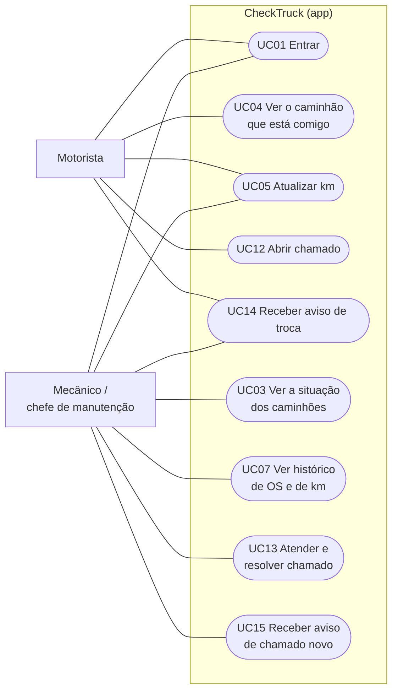
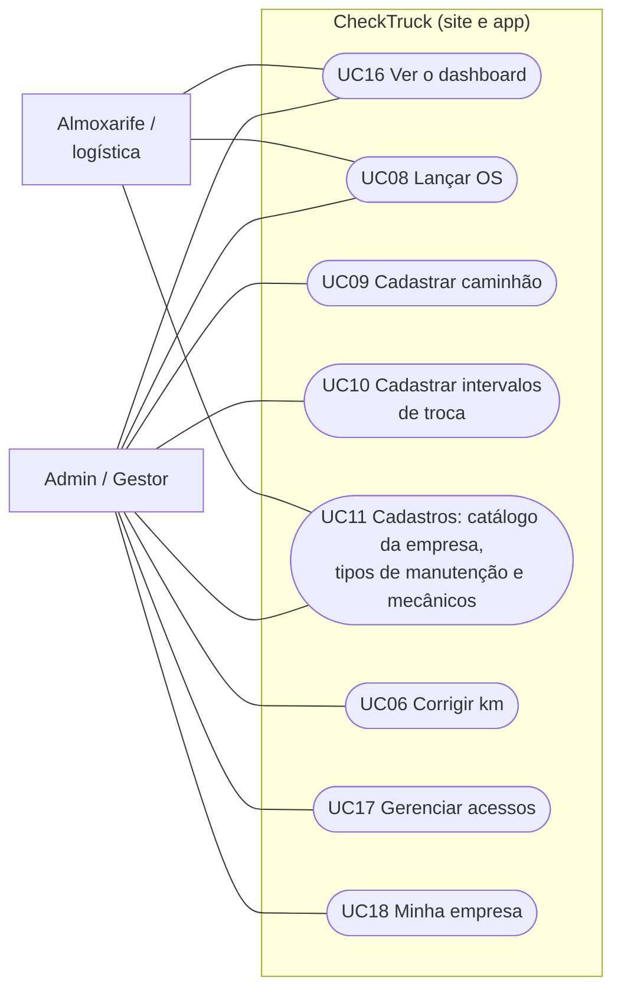
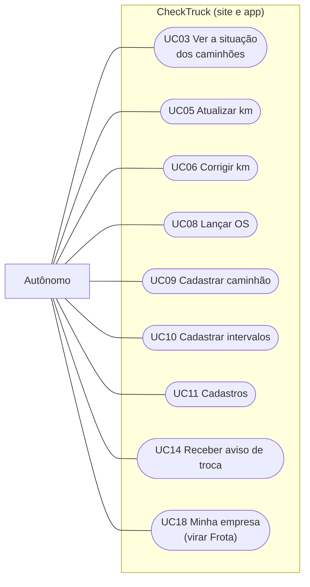
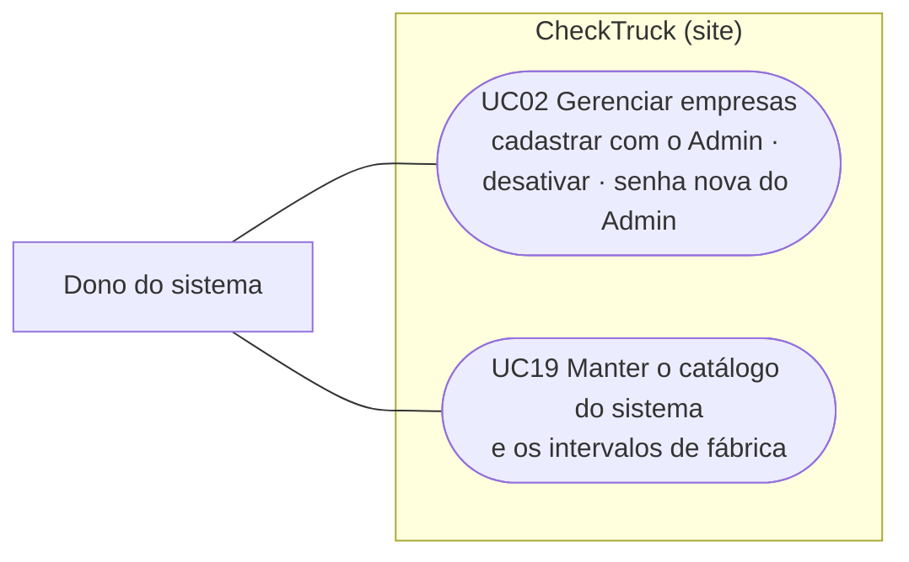

# Casos de uso

No CheckTruck, o que cada pessoa faz não depende só do cargo: o Admin ou o Gestor libera **permissões**, uma por
uma, para cada acesso (ver a tabela em [Acessos](../README.md#acessos)). Os diagramas mostram o uso típico de cada
perfil, e a tabela no fim diz exatamente qual permissão libera cada caso de uso.

## Motorista e mecânico (campo)

O motorista só vê e mexe no caminhão em que ele é o **motorista atual** (quem coloca é o gestor, no cadastro do
caminhão, ou a OS). Sem caminhão, o app avisa para falar com o gestor.

## Escritório (almoxarife, gestor e admin)

Admin e Gestor podem tudo, inclusive os casos de uso do campo. Só eles cuidam dos acessos e corrigem o km.

## Autônomo

O Autônomo é o dono de um ou poucos caminhões e faz tudo sozinho. Não tem chamados nem outros acessos; se
contratar gente, **vira Frota** em Minha empresa e ganha os dois.

## Dono do sistema

O dono do sistema é um login à parte, sem empresa. Ele cadastra cada empresa cliente com o login do Admin dela
(não existe criar conta), e o Admin cadastra o resto da equipe (UC17). Também mantém os fabricantes, modelos,
gerações e intervalos de fábrica que todas as empresas usam.

## Casos de uso × permissões

| Caso de uso | Quem pode | Onde |
|---|---|---|
| UC01 Entrar (o login renova sozinho) | Todos os acessos ativos | Site e app |
| UC02 Gerenciar empresas (cadastrar com o Admin, desativar, senha nova do Admin) | Dono do sistema | Site |
| UC03 Ver a situação dos caminhões | Ver frota | Site e app |
| UC04 Ver o caminhão que está comigo | Motorista que é o motorista atual | App |
| UC05 Atualizar km | Atualizar km; o motorista, no caminhão dele (pelo app) | Site e app |
| UC06 Corrigir km (com motivo) | Admin e Gestor | Site e app |
| UC07 Ver histórico de OS e de km | Ver frota | Site e app |
| UC08 Lançar, editar e excluir OS | Ordem de serviço | Site e app |
| UC09 Cadastrar, editar e desativar caminhão | Veículos | Site e app |
| UC10 Cadastrar intervalos (do caminhão e da empresa) | Intervalos | Site e app |
| UC11 Cadastros (catálogo da empresa, tipos, mecânicos) | Cadastros | Site e app |
| UC12 Abrir chamado | Abrir chamados (só na Frota; o motorista, só do caminhão dele) | Site e app |
| UC13 Atender e resolver chamado | Atender chamados (só na Frota) | Site e app |
| UC14 Receber aviso de troca | Motorista e quem tem Ver frota | App |
| UC15 Receber aviso de chamado novo | Atender chamados (menos quem abriu) | App |
| UC16 Ver o dashboard | Ver frota | Site |
| UC17 Gerenciar acessos | Admin e Gestor (só na Frota) | Site |
| UC18 Minha empresa / virar Frota | Admin e Gestor (e o Autônomo) | Site e app |
| UC19 Manter o catálogo do sistema | Dono do sistema | Site |

## Antes e depois

| Etapa | Antes (sem o sistema) | Com o CheckTruck |
|---|---|---|
| Fazer a manutenção | O registro fica só no sistema da concessionária | O almoxarife (ou o autônomo) lança a OS no mesmo dia, pelo site ou pelo app |
| Guardar o histórico | Espalhado entre concessionárias; a empresa não tem cópia | Histórico de OS e de km de cada caminhão, sempre à mão |
| Saber a próxima troca | Memória do gestor ou anotação | O sistema calcula por km e por data, pelo intervalo que vale para aquele caminhão |
| Ser avisado | Descobre quando já venceu | Atenção quando falta 10% do ciclo (no mínimo 5.000 km) ou 30 dias; crítico quando vence; aviso no celular |
| Problema no caminhão | Recado de boca ou por WhatsApp | O motorista abre um chamado pelo app e quem atende recebe o aviso na hora |
