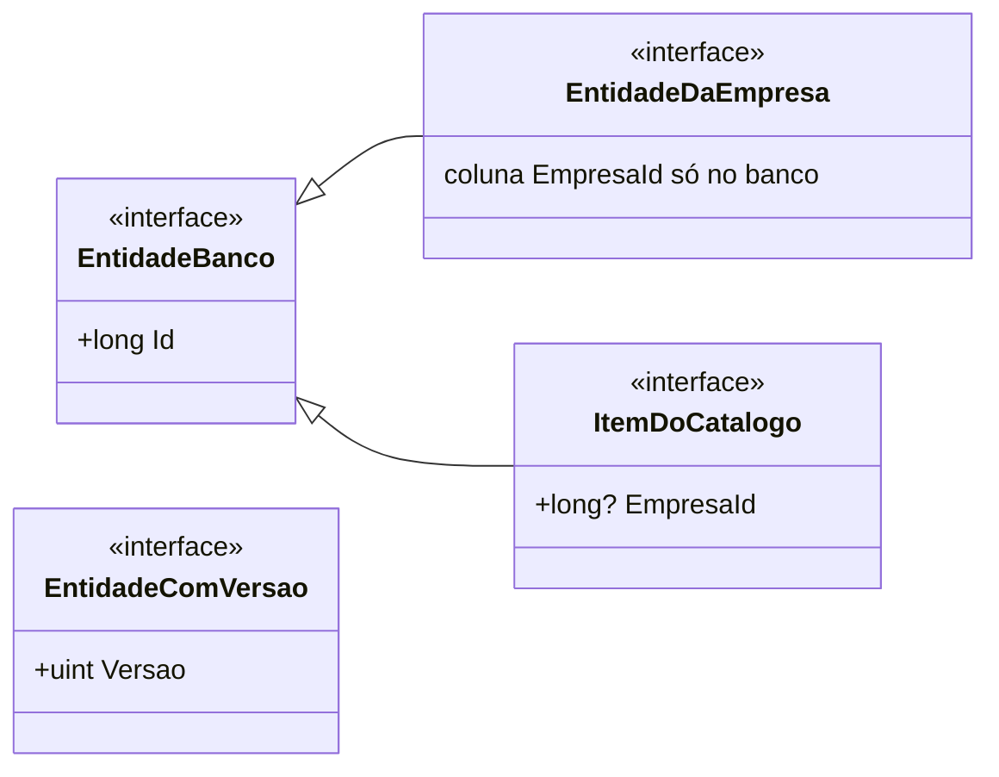
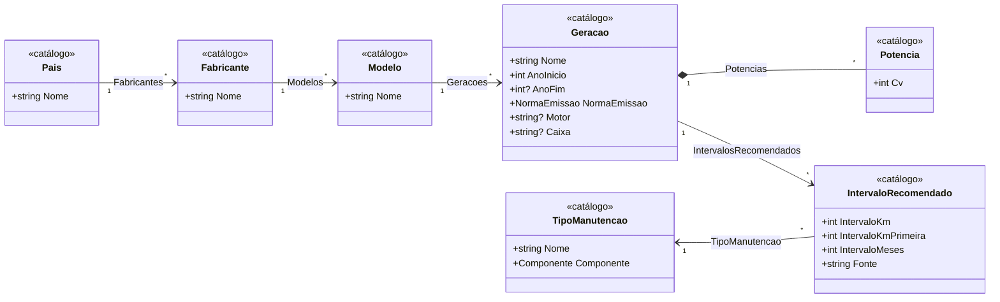
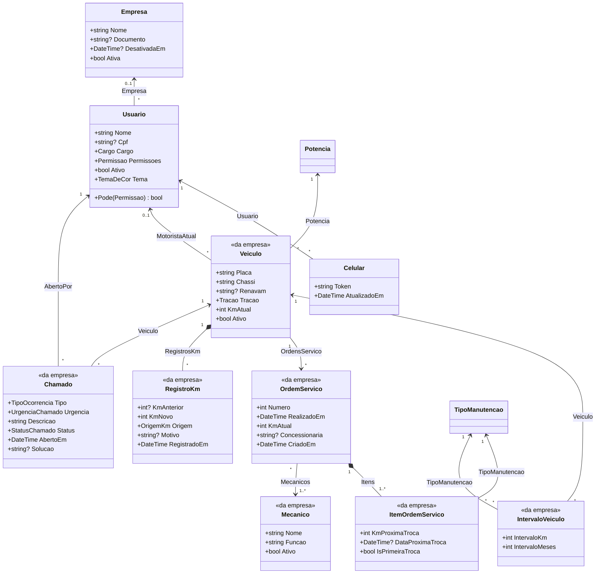
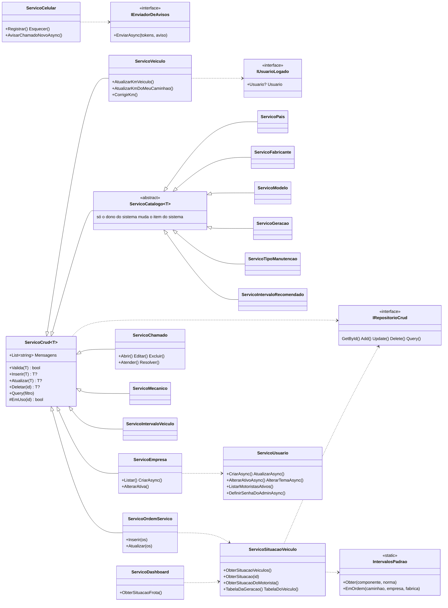

# Domínio (classes)

O projeto `CheckTruck.Dominio` tem as entidades (o que o sistema guarda), os enums e os serviços (as regras). As
entidades são simples: só os dados e os relacionamentos. As regras ficam nos serviços.

## Entidades

Toda entidade implementa uma destas interfaces; o `Context` do EF usa a interface para saber como separar
os dados por empresa.

### Catálogo

### Empresa, frota e chamados

- **<<da empresa>>** implementa `EntidadeDaEmpresa` (dados de um cliente; a coluna da empresa fica só no banco).
  **<<catálogo>>** implementa `ItemDoCatalogo` (sem empresa = do sistema; com empresa = dela). `Empresa` e
  `Celular` são `EntidadeBanco` simples.
- `Veiculo` e `OrdemServico` também implementam `EntidadeComVersao`: a versão muda a cada gravação (no PostgreSQL, a
  coluna `xmin`). Quem edita manda a versão que abriu e, se alguém gravou antes, nada é gravado e a pessoa recebe
  "Alguém mudou isso enquanto você editava".
- `Usuario` herda de `IdentityUser` (ASP.NET Identity), que traz o e-mail, o hash da senha e o bloqueio.
- Composição (◆): a potência só existe dentro da geração, o item só dentro da OS e o histórico de km só dentro do
  caminhão.

## Enums

| Enum | Valores |
|------|---------|
| `Cargo` | Admin, Gestor, Almoxarife, Mecanico, ChefeManutencao, TecnicoLogistica, AuxiliarLogistica, Motorista, DonoDoSistema |
| `Permissao` (bits) | VerFrota, Veiculos, AtualizarKm, OrdemServico, Cadastros, Intervalos, AbrirChamados, AtenderChamados |
| `Componente` | Motor, Cambio, Diferencial1, Diferencial2, Filtro, Embreagem |
| `NormaEmissao` | AntesDoEuro5, Euro5, Euro6 |
| `Tracao` | QuatroPorDois, SeisPorDois, SeisPorQuatro, OitoPorDois, OitoPorQuatro |
| `OrigemKm` | Cadastro, AtualizarKm, OrdemServico, Edicao, Correcao |
| `OrigemIntervalo` | Veiculo, Empresa, Fabrica, Padrao (nessa ordem de prioridade) |
| `StatusManutencao` | Ok, Atencao, Critico |
| `TipoOcorrencia` | RuidoMotor, Freios, PneuSuspensao, EletricaPainel, Vazamento, ArCondicionado, PreventivaVencida, Outro |
| `UrgenciaChamado` | Baixa, Media, Alta (aparece como "Urgente") |
| `StatusChamado` | Pendente, Concluido |
| `TemaDeCor` | Verde, Azul, Amarelo, Preto (a cor do site e do app de cada pessoa; Verde é o padrão) |

`Permissao` é um enum de bits: as permissões de uma pessoa ficam num número só (ex.: VerFrota + AtualizarKm =
1 + 4 = 5). Admin e Gestor têm todas, sem precisar marcar.

## Serviços

| Serviço | O que decide |
|---------|--------------|
| `ServicoSituacaoVeiculo` | A situação de cada caminhão: para cada item, a próxima troca (km e data), quanto falta e o status. É o coração do sistema; site, app e dashboard usam o mesmo cálculo. |
| `IntervalosPadrao` | A ordem em que os intervalos valem (caminhão → empresa → fábrica → padrão seguro) e o padrão seguro de cada componente. É o único lugar com essa ordem. |
| `ServicoOrdemServico` | Lançar e editar OS: calcula a próxima troca de cada item (quando a OS não traz), sobe o km do caminhão e troca o motorista atual. |
| `ServicoVeiculo` | Cadastro do caminhão e o km: só sobe (Atualizar km, OS, edição); a correção (Admin e Gestor) pode baixar, com motivo. Toda mudança vai para o histórico. |
| `ServicoChamado` | Abrir (o motorista só do caminhão dele), editar e excluir enquanto pendente, atender e resolver. |
| `ServicoCelular` | Guardar o celular de quem entrou e avisar de chamado novo quem pode atender. |
| `ServicoUsuario` | Acessos: cadastrar, editar, ativar e desativar (só Admin e Gestor; o acesso de um Admin, só um Admin), sempre na própria empresa. Para o dono do sistema, os Admins das empresas e a senha nova de cada um. |
| `ServicoEmpresa` | Empresas (só o dono do sistema): cadastrar com o primeiro acesso (Admin), desativar e ativar. |
| `ServicoCatalogo<T>` e filhos | Itens do catálogo: o do sistema só o dono do sistema muda; nome que não repete; não exclui o que está em uso. |
| `ServicoDashboard` | Resumo da frota para o dashboard: quantos itens em cada status, alertas e caminhões por geração. |

`ServicoCrud<T>` é a base: valida, grava pelo `IRepositorioCrud` e junta as mensagens de erro (em português) que
a API devolve. Os serviços nunca acessam o banco direto, só pelo repositório, por isso os testes trocam o banco
por um repositório em memória.
