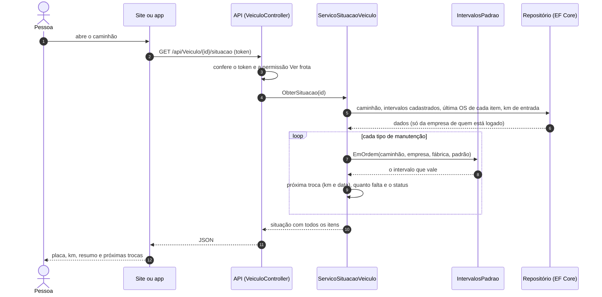
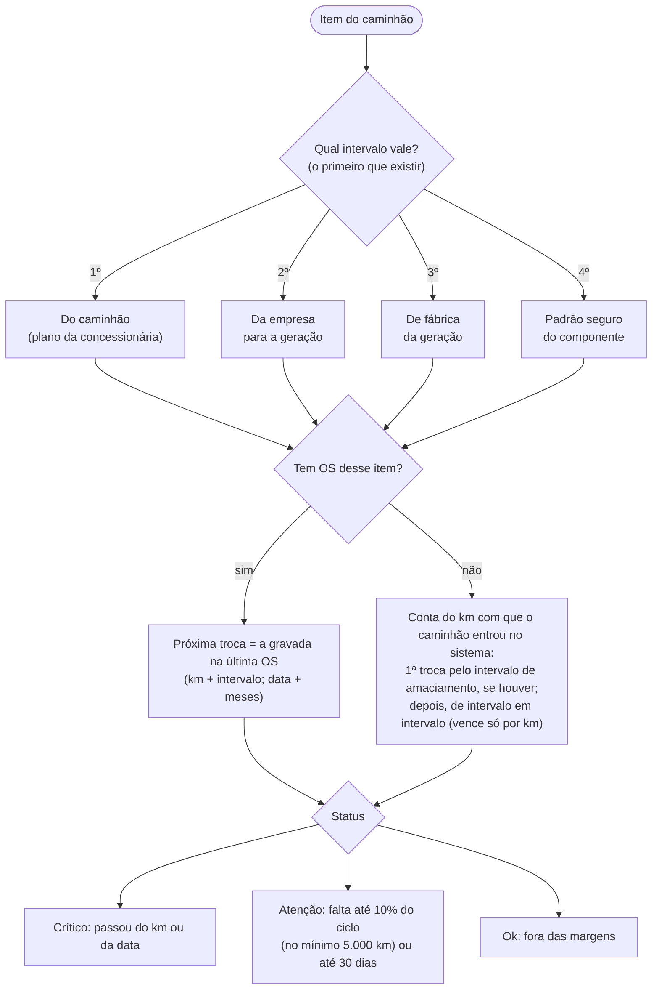
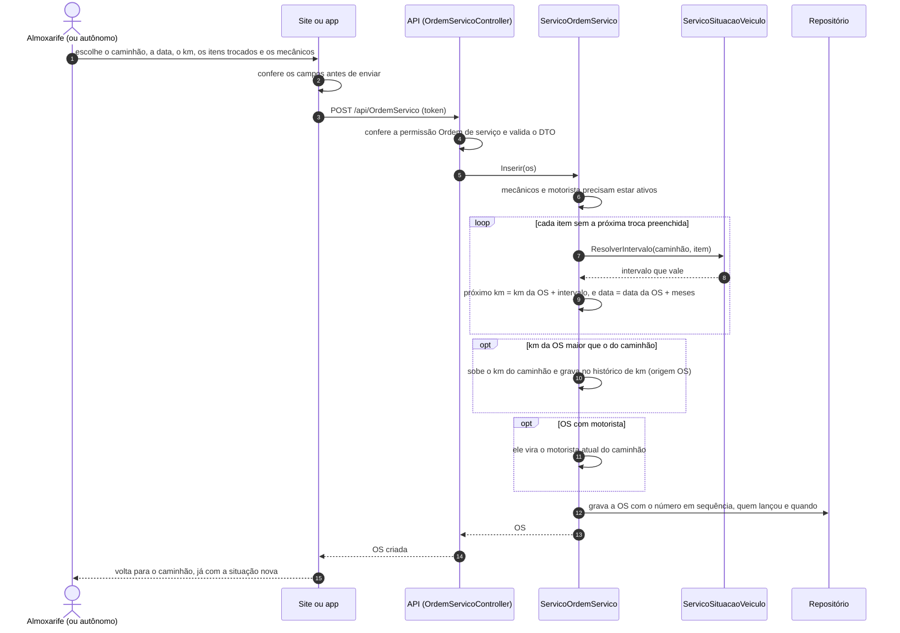
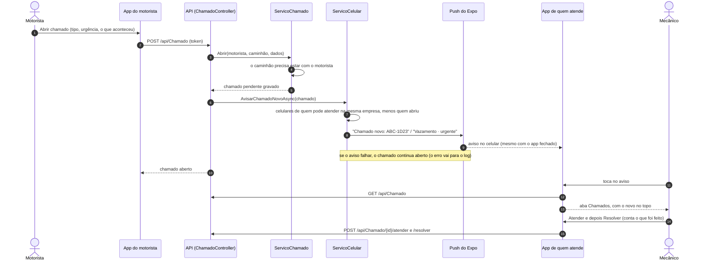
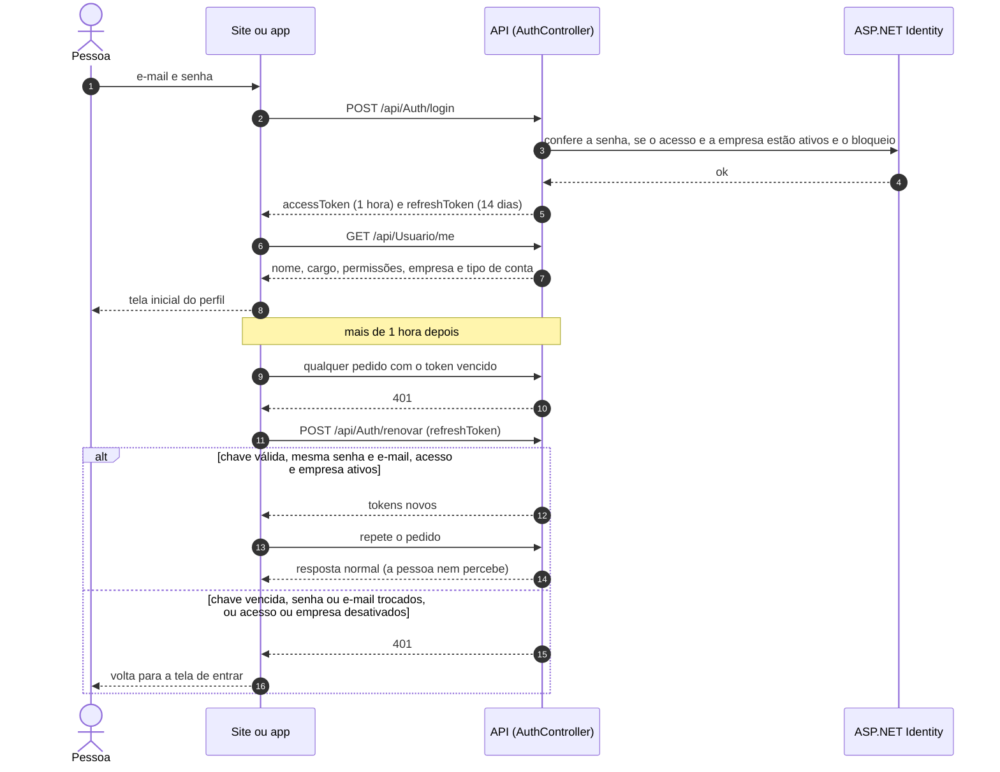
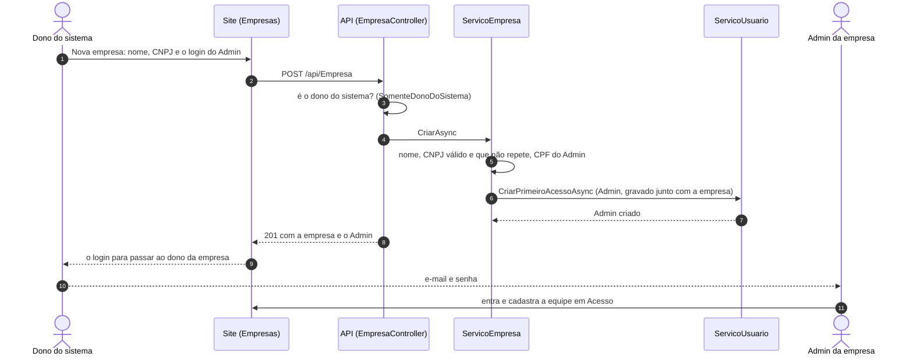
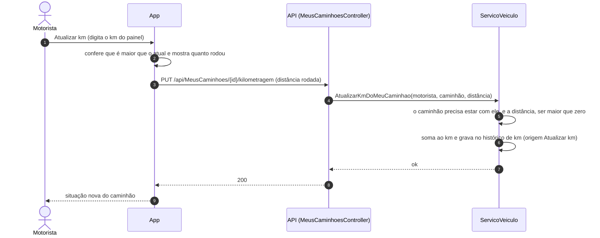
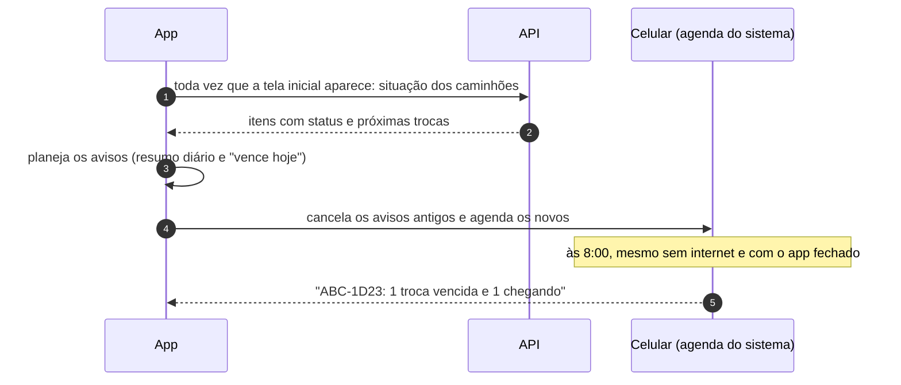

# Fluxos principais

Como as partes conversam nos casos de uso mais importantes.

## Situação do caminhão (o cálculo central)

Toda tela que mostra o status (lista de caminhões, detalhe, dashboard, painel do motorista, avisos do celular) pede
para a API, e a API calcula na hora em `ServicoSituacaoVeiculo`. Assim, site e app mostram sempre o mesmo resultado.

Para cada item, o cálculo é este:

Vence o que chegar primeiro: o km ou a data. O status do item é o pior dos dois, e o do caminhão é o pior dos
itens.

## Lançar uma ordem de serviço

Se o item não tiver intervalo em nenhum lugar e a OS não trouxer o km da próxima troca, a API recusa com uma
mensagem: "Não há intervalo cadastrado para … Informe o km da próxima troca ou cadastre o intervalo."

## Abrir um chamado e avisar quem atende

O celular entra nessa lista quando a pessoa abre o app logada e com os avisos ligados (`PUT /api/Celular`), e sai
quando ela toca em Sair (`DELETE /api/Celular`). Um celular fica com quem entrou nele por último.

## Entrar e continuar logado

O site guarda os tokens no navegador; o app, no cofre do celular. Vários pedidos vencidos ao mesmo tempo
esperam uma renovação só.

## Dono do sistema cadastra uma empresa

Não existe criar conta: o login de cada empresa nasce aqui, e o Admin dela cadastra o resto da equipe.

Desativar a empresa (`PUT /api/Empresa/{id}/ativa` com `false`) não apaga nada: ninguém dela entra, quem estava
dentro recebe 401 no próximo pedido e a renovação do login também é recusada. Ativar de novo devolve o acesso a
todos.

## Motorista atualiza o km

Ninguém baixa o km pelo Atualizar km. Se alguém digitar errado (ex.: um zero a mais), o Admin ou o Gestor usa
**Corrigir km**, com motivo, e não pode baixar para menos que o km da maior OS.

## Avisos de troca (no próprio celular)

Os avisos de troca não passam pelo servidor: o celular agenda sozinho (até 60 avisos) e o app refaz a agenda
toda vez que abre. Ao sair, os avisos são apagados.
