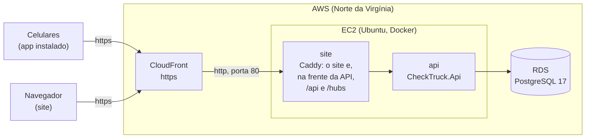

# Servidor (AWS)

Como o CheckTruck roda na nuvem, para o site e o app funcionarem sem o PC de ninguém ligado. Os arquivos ficam na
pasta [`servidor`](../servidor) do projeto.



| Peça | O que faz |
|------|-----------|
| **CloudFront** | O endereço do sistema, com https (`https://xxxx.cloudfront.net`). Quem chega por http vai para o https. Deixa passar o canal de mudanças (WebSocket). |
| **EC2** (Ubuntu, `t4g.small`) | Roda o Docker com dois containers (`servidor/compose.yaml`): o **site** (Caddy) e a **api**. Só a porta 80 fica aberta, e só para o CloudFront. Se a máquina reiniciar, os dois voltam sozinhos. |
| **RDS** (PostgreSQL 17, `db.t4g.micro`) | O banco. A AWS faz o backup todo dia e cuida das atualizações. Não abre para a internet: só a EC2 chega nele. |

O site e a API ficam no mesmo endereço: o Caddy entrega o site e repassa `/api` e `/hubs` para a API. Por isso o
site publicado não precisa de CORS, e o app só precisa saber o endereço do CloudFront.

## O que a API faz diferente no servidor

Fora do desenvolvimento (`ASPNETCORE_ENVIRONMENT` diferente de `Development`, que é o padrão do container):

- **Aplica as migrations sozinha** ao subir (`Database.MigrateAsync`), e cria o banco `checktruck` se ele não existir.
- **Primeiros logins:** cria o `admin@admin.com` e o `dono@checktruck.com` com as senhas de `ContasIniciais__SenhaDoAdmin`
  e `ContasIniciais__SenhaDoDono`, só quando eles ainda não existem. Sem essas variáveis, a API não sobe. As senhas
  do README (`Admin@123` e `Dono@123`) só existem no desenvolvimento.
- **Erro 500** sai no mesmo formato dos outros erros, com "Algo deu errado do nosso lado. Tente de novo em instantes."
  O detalhe técnico fica só no log.
- **CORS desligado** (só o desenvolvimento precisa).

Nos dois ambientes (`CheckTruck.Api/Servidor/Protecoes.cs`):

- **Limite de login por IP:** 10 tentativas por minuto; passou disso, 429 com "Muitas tentativas de entrar. Espere 1
  minuto e tente de novo." O bloqueio da conta (5 senhas erradas) continua valendo.
- **IP de quem acessou:** vem do `X-Forwarded-For` (o 2º da direita, o que o CloudFront pôs).
- **Saúde:** `GET /api/saude` responde `Healthy` quando a API está no ar e fala com o banco.
- **Chaves do token** na pasta de `ChavesDoToken__Pasta` (no servidor, o volume `chaves-do-token`): reiniciar ou
  atualizar a API não desloga ninguém.

## Configuração (`servidor/.env`)

O `.env` fica só no servidor e não vai para o Git. O modelo é o [`.env.exemplo`](../servidor/.env.exemplo):

| Variável | O que é |
|----------|---------|
| `ConnectionStrings__DefaultConnection` | Conexão com o RDS (endereço, usuário e senha do banco), com `SSL Mode=Require` |
| `ContasIniciais__SenhaDoAdmin` | Senha do `admin@admin.com` na primeira vez |
| `ContasIniciais__SenhaDoDono` | Senha do `dono@checktruck.com` na primeira vez |

Nas senhas, não use `$`: o Docker entende como variável.

## Subir pela primeira vez

1. **EC2:** Ubuntu Server 24.04 (Arm), `t4g.small`, 20 GB de disco, com um IP elástico (o endereço não muda quando
   a máquina reinicia). Liberar SSH (para o EC2 Instance Connect, o terminal pelo navegador) e HTTP.
2. **RDS:** PostgreSQL 17, `db.t4g.micro`, ligado à EC2 pela opção "Connect to an EC2 compute resource" (a AWS cria
   as regras de acesso entre os dois), sem acesso público, backup de 7 dias.
3. **No terminal da EC2** (EC2 Instance Connect):

   ```bash
   git clone https://github.com/LeandroPoletti/CheckTruck.git
   cd CheckTruck/servidor
   sh preparar.sh          # memória extra (swap) e Docker; só na primeira vez
   cp .env.exemplo .env
   nano .env               # preencher o endereço e a senha do banco e as senhas dos dois logins
   sh atualizar.sh         # compila e sobe a API e o site
   ```

4. **CloudFront:** origem = o endereço público da EC2 (porta 80, só http); http vai para https; todos os métodos
   (GET, POST, PUT, DELETE...); sem cache (`CachingDisabled`) e repassando tudo de quem chamou (`AllViewer`).
5. **Fechar a porta 80** para o resto da internet: no grupo de segurança da EC2, a regra HTTP passa a aceitar só a
   lista do CloudFront (`com.amazonaws.global.cloudfront.origin-facing`).
6. **Conferir:** `https://xxxx.cloudfront.net/api/saude` mostra `Healthy`, e o site abre em `https://xxxx.cloudfront.net`.

## Atualizar

Depois de um push na `main`, no terminal da EC2:

```bash
cd CheckTruck/servidor
sh atualizar.sh
```

Ele baixa o código novo, recompila a API e o site, sobe os dois de novo (as migrations novas entram sozinhas) e
apaga as imagens velhas do Docker.

Para ver o log da API: `sudo docker compose logs -f api` (na pasta `servidor`).

## App do celular (APK)

O APK é o app instalado no Android: funciona sem o PC ligado e fala com o endereço do CloudFront. O endereço entra
no app na hora de gerar o APK, pela variável `EXPO_PUBLIC_API_URL` do perfil `apk` no `CheckTruck.Mobile/eas.json`
(`https://xxxx.cloudfront.net`, sem barra no fim). Se o endereço mudar, troque lá e gere de novo.

Para gerar, na pasta `CheckTruck.Mobile`, com a conta do Expo dona do projeto (`brenocolonello`):

```bash
npm install
npx eas-cli@latest build -p android --profile apk
```

O APK é montado nos servidores do Expo (no plano grátis ele pode esperar numa fila). Na primeira vez, o comando
pergunta se pode criar a chave que assina o app: responda que sim. A chave fica guardada na conta do Expo, e os
próximos APKs saem com a mesma. No fim aparecem o link e o QR code para baixar.

Para instalar, abra o link no celular, baixe o APK e toque nele. O Android pede para permitir a instalação pelo
navegador e, se o Play Protect avisar, é só tocar em instalar mesmo assim. Um APK novo instala por cima do antigo, e
quem estava logado continua logado.

Mudou alguma coisa no app? Gere e instale o APK de novo. Mudanças no site e na API não precisam: basta atualizar o
servidor. O aviso de chamado novo ainda não chega no APK (no Android ele precisa do Firebase); os avisos de troca
funcionam.
