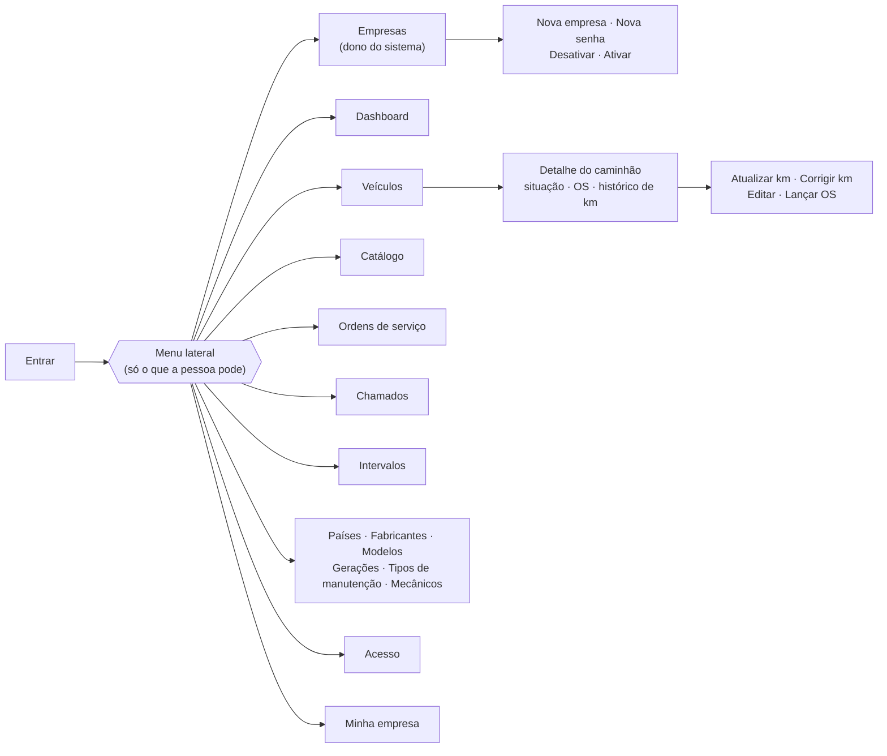
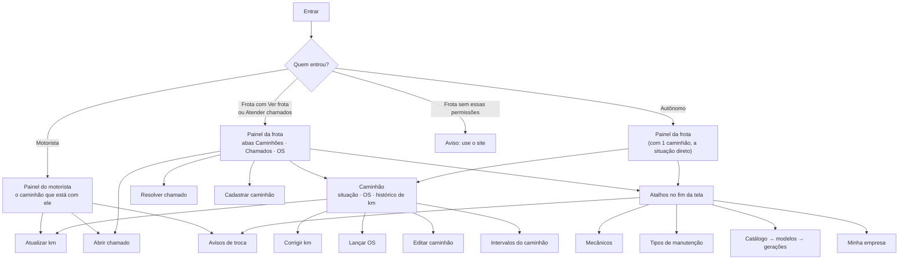

# Telas e navegação

O site e o app mostram só o que as permissões de quem entrou liberam. Quem decide de verdade é a API: esconder
uma tela é só para não confundir.

## Site

| Grupo do menu | Tela | Precisa de |
|---|---|---|
| — | Empresas | Dono do sistema |
| — | Dashboard | Ver frota |
| Frota | Veículos (e o detalhe de cada um) | Ver frota |
| Frota | Catálogo | Cadastros |
| Manutenção | Ordens de serviço | Ver frota |
| Manutenção | Chamados | Abrir ou Atender chamados (só na Frota) |
| Manutenção | Intervalos | Intervalos |
| Cadastros | Países, Fabricantes, Modelos, Gerações, Tipos de manutenção | Cadastros |
| Cadastros | Mecânicos (no Autônomo, "Oficinas e mecânicos") | Cadastros (não aparece para o dono do sistema) |
| — | Acesso | Admin ou Gestor (só na Frota) |
| — | Minha empresa | Admin ou Gestor (e o Autônomo) |

Os botões dentro das telas também seguem as permissões: Atualizar km (Atualizar km), Corrigir km (Admin e
Gestor), Editar (Veículos), Lançar OS (Ordem de serviço).

Não tem tela de criar conta: a tela Entrar diz para pedir o acesso ao gestor da empresa. Na tela **Empresas** o
dono do sistema cadastra a empresa com o Admin dela (e vê o login para passar ao dono da empresa), define uma senha
nova para o Admin e desativa ou ativa a empresa (abas Ativas e Desativadas).

## App

A tela inicial muda conforme quem entrou. As janelas de formulário sobem por cima da tela (modal) e voltam para
onde a pessoa estava.

| Tela (arquivo em `src/app`) | O que faz | Quem vê |
|---|---|---|
| `login` | Entrar (sem criar conta: o acesso vem do admin ou do gestor) | Todos |
| `(app)/index` | Tela inicial de cada perfil (`src/telas`) | Logado |
| `(app)/caminhao/[id]` | Situação, próximas trocas, OS e histórico de km do caminhão | Ver frota |
| `(app)/atualizar-km` | Atualizar km (o motorista, no caminhão dele) | Atualizar km ou motorista |
| `(app)/corrigir-km` | Baixar um km digitado errado, com motivo | Admin e Gestor |
| `(app)/lancar-os` | Lançar OS (cadastrando o mecânico ali mesmo) | Ordem de serviço |
| `(app)/cadastro-caminhao` | Cadastrar e editar caminhão | Veículos |
| `(app)/abrir-chamado`, `(app)/resolver-chamado` | Abrir, atender e resolver chamados | Abrir / Atender chamados |
| `(app)/intervalos`, `(app)/intervalo` | Intervalos por caminhão e por geração | Intervalos |
| `(app)/mecanicos`, `(app)/mecanico` | Mecânicos (no Autônomo, oficinas e mecânicos) | Cadastros |
| `(app)/tipos-manutencao`, `(app)/tipo-manutencao` | Tipos de manutenção | Cadastros |
| `(app)/catalogo`, `modelos`, `geracoes`, `fabricante`, `modelo`, `geracao` | Catálogo, um nível por vez | Cadastros |
| `(app)/avisos` | Avisos de troca: se estão ligados, os próximos e um aviso de teste | Motorista e Ver frota |
| `(app)/minha-empresa` | Dados da conta e virar Frota | Admin e Gestor (e o Autônomo) |

Ficam só no site: o **dashboard**, os **acessos** (cadastrar pessoas e permissões) e as telas do **dono do
sistema** (empresas e catálogo do sistema).

## Visual

- Mesma paleta verde no site e no app; títulos em Barlow Semi Condensed (fonte de placa de estrada) e texto em Inter.
- Status em cores: verde (ok), amarelo (atenção) e vermelho (crítico). No app, a placa aparece no padrão Mercosul.
- Pensado para quem tem pouca prática com celular: botões com cara de botão, textos curtos e simples, e cada
  ação no lugar onde a pessoa procura.
