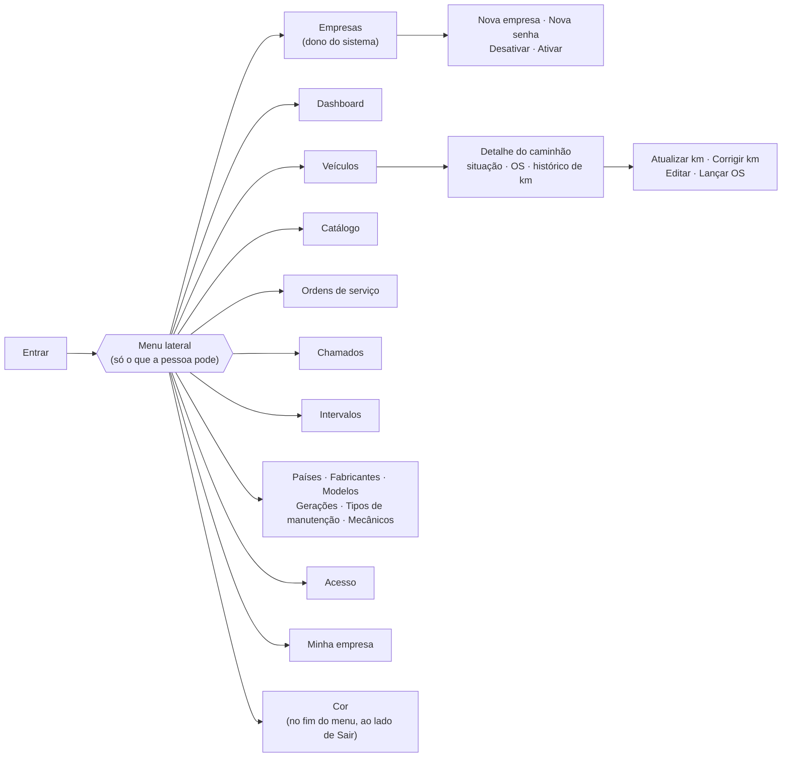
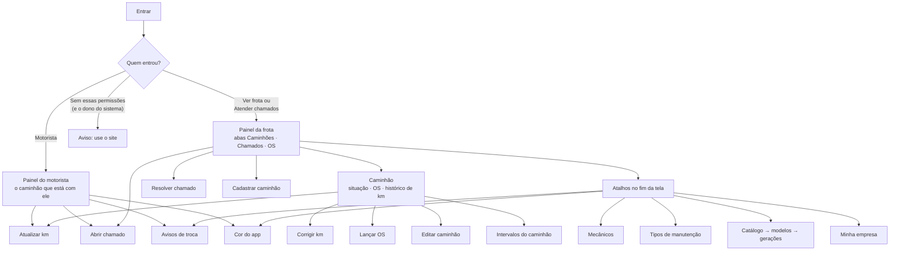

# Telas e navegação

O site e o app mostram só o que as permissões de quem entrou liberam. Quem decide de verdade é a API: esconder
uma tela é só para não confundir.

## Site

| Grupo do menu | Tela | Precisa de |
|---|---|---|
| — | Empresas | Dono do sistema |
| — | Dashboard | Ver frota |
| Frota | Veículos (e o detalhe de cada um) | Ver frota |
| Frota | Catálogo | Cadastros |
| Manutenção | Ordens de serviço | Ver frota |
| Manutenção | Chamados | Abrir ou Atender chamados |
| Manutenção | Intervalos | Intervalos |
| Cadastros | Países, Fabricantes, Modelos, Gerações, Tipos de manutenção | Cadastros |
| Cadastros | Mecânicos | Cadastros (não aparece para o dono do sistema) |
| — | Acesso | Admin ou Gestor |
| — | Minha empresa | Admin ou Gestor |

Ordens de serviço e o histórico de manutenções do detalhe do caminhão têm o filtro de **período**, pela data da troca:
Tudo, Este mês, Últimos 3 meses, Este ano ou Escolher datas (De e Até). O app tem o mesmo filtro, na aba OS e no
detalhe do caminhão.

Os botões dentro das telas também seguem as permissões: Atualizar km (Atualizar km), Corrigir km (Admin e
Gestor), Editar (Veículos), Lançar OS (Ordem de serviço).

No fim do menu, embaixo do nome de quem entrou, ficam **Cor** (todo mundo: abre a janela para escolher a cor do
sistema) e **Sair**.

Não tem tela de criar conta: a tela Entrar diz para pedir o acesso ao gestor da empresa. Na tela **Empresas** o
dono do sistema cadastra a empresa com o Admin dela (e vê o login para passar ao dono da empresa), define uma senha
nova para o Admin e desativa ou ativa a empresa (abas Ativas e Desativadas).

## App

A tela inicial muda conforme quem entrou. As janelas de formulário sobem por cima da tela (modal) e voltam para
onde a pessoa estava.

| Tela (arquivo em `src/app`) | O que faz | Quem vê |
|---|---|---|
| `login` | Entrar (sem criar conta: o acesso vem do admin ou do gestor) | Todos |
| `(app)/index` | Tela inicial de cada perfil (`src/telas`) | Logado |
| `(app)/caminhao/[id]` | Situação, próximas trocas, OS (com o filtro de período) e histórico de km do caminhão | Ver frota |
| `(app)/atualizar-km` | Atualizar km (o motorista, no caminhão dele) | Atualizar km ou motorista |
| `(app)/corrigir-km` | Baixar um km digitado errado, com motivo | Admin e Gestor |
| `(app)/lancar-os` | Lançar OS (cadastrando o mecânico ali mesmo) | Ordem de serviço |
| `(app)/cadastro-caminhao` | Cadastrar e editar caminhão | Veículos |
| `(app)/abrir-chamado`, `(app)/resolver-chamado` | Abrir, atender e resolver chamados | Abrir / Atender chamados |
| `(app)/intervalos`, `(app)/intervalo` | Intervalos por caminhão e por geração | Intervalos |
| `(app)/mecanicos`, `(app)/mecanico` | Mecânicos | Cadastros |
| `(app)/tipos-manutencao`, `(app)/tipo-manutencao` | Tipos de manutenção | Cadastros |
| `(app)/catalogo`, `modelos`, `geracoes`, `fabricante`, `modelo`, `geracao` | Catálogo, um nível por vez | Cadastros |
| `(app)/avisos` | Avisos de troca: se estão ligados, os próximos e um aviso de teste | Motorista e Ver frota |
| `(app)/minha-empresa` | Dados da empresa | Admin e Gestor |
| `(app)/cor` | Cor do app: verde, azul, amarelo ou preto (a mesma do site) | Motorista, Ver frota ou Atender chamados |

Ficam só no site: o **dashboard**, os **acessos** (cadastrar pessoas e permissões) e as telas do **dono do
sistema** (empresas e catálogo do sistema).

## Visual

- O verde das placas de estrada, com o amarelo da faixa do meio da estrada nos detalhes (no menu do site, a faixa
  amarela marca a tela aberta).
- Quatro cores para escolher: verde (o padrão), azul (da placa Mercosul), amarelo (das placas de advertência: no
  site, o menu em grafite com a logo e a tela aberta em amarelo; no app, o topo amarelo com a letra escura) e preto.
  Cada pessoa escolhe a dela (Cor, no menu do site; Cor do app, no fim da tela inicial do app), que fica na conta e
  vale no site e no app. Muda só o que é colorido (topo, menu, botões, logo e desenhos): o fundo continua claro, e as
  cores do status são as mesmas em todas.
- Logo própria: uma placa de estrada com o "visto" desenhado como uma estrada. Aparece no menu do site, no topo da
  tela inicial do app e nos dois logins, na cor escolhida, e no ícone da aba do navegador e no ícone do app no
  celular, sempre em verde.
- Desenhos: o caminhão na estrada no login (site e app) e no dashboard do site, e a estrada vazia nas telas sem
  nada cadastrado.
- Letras iguais no site e no app: títulos e números grandes em Overpass (feita a partir da letra das placas de
  estrada), texto em Inter e as letras da placa em Barlow Semi Condensed.
- Nas listas de caminhões do app, cada cartão tem uma faixa na esquerda com a cor do status.
- Status em cores: verde (ok), amarelo (atenção) e vermelho (crítico). A placa do caminhão aparece no padrão
  Mercosul, no site e no app.
- Pensado para quem tem pouca prática com computador e celular: letras maiores, botões com cara de botão (com
  sombra embaixo, inclusive Editar e Excluir nas tabelas), textos curtos e simples, sem nada em maiúsculas, e
  cada ação no lugar onde a pessoa procura.
